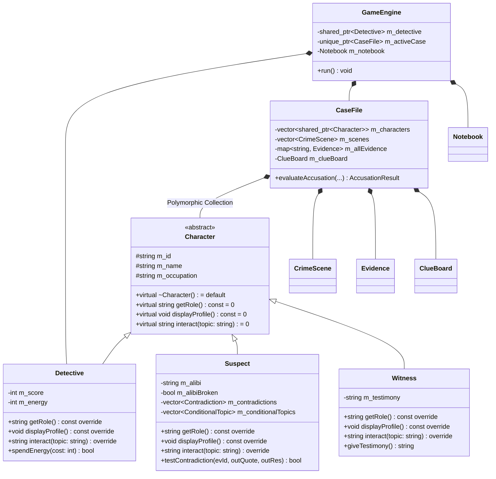

# CASE CLOSED — Detective Mystery Simulator

<div align="center">

```text
========================================================================
      ____    _    ____  _____   ____ _     ___  ____  _____ ____           
     / ___|  / \  / ___|| ____| / ___| |   / _ \/ ___|| ____|  _ \      
    | |     / _ \ \___ \|  _|  | |   | |  | | | \___ \|  _| | | | |     
    | |___ / ___ \ ___) | |___ | |___| |__| |_| |___) | |___| |_| |     
     \____/_/   \_\____/|_____| \____|_____\___/|____/|_____|____/      
========================================================================
     FORENSIC & DEDUCTIVE MYSTERY SIMULATOR IN STANDARD C++17
========================================================================
```

**An interactive terminal mystery simulator demonstrating Object-Oriented Programming (OOP) fundamentals in C++17.**


</div>

---

## 1. Project Abstract & Problem Statement

### Abstract
**CASE CLOSED** is a console-based detective mystery simulator developed in standard C++17. The player assumes the role of a consulting detective investigating three distinct criminal cases. Unlike superficial multiple-choice question games, progression in *Case Closed* is strictly logic-driven: the player examines crime scenes, collects physical and documentary clues, conducts suspect interrogations with evidence-unlocked dialogue choices, exposes verbal contradictions using discovered evidence, and links clues on a virtual Clue Board. The final accusation requires the player to identify the culprit, specify the decisive evidence, and explain the criminal motive before the High Magistrate.

### Problem Statement
Traditional computer-science classroom assignments frequently teach Object-Oriented Programming concepts (abstraction, inheritance, runtime polymorphism, and encapsulation) through disconnected synthetic examples (e.g. `Animal` -> `Dog`, `Shape` -> `Circle`). *Case Closed* solves this pedagogical gap by applying these concepts to a unified, production-grade terminal game where class hierarchies, virtual function tables, smart pointers, and associative containers directly drive game mechanics.

---

## 2. Key Objectives & Features

- **Standard C++17 Only:** Zero external third-party dependencies (no Python, JavaScript, SDL, or external engines). Compatible with MinGW `g++` and GCC.
- **Three Original Mystery Cases:**
  1. *The Midnight Museum Heist:* Grand larceny of the 45-carat sapphire during a deliberate 4-minute blackout.
  2. *The Last Train Mystery:* Fast-acting cyanide poisoning of a shipping tycoon aboard an express liner with no stops.
  3. *The Locked Room Incident:* Homicide of an eccentric clockmaker inside a study bolted from the inside.
- **Deep Mystery Design:**
  - At least **4 suspects** per case with unique motives, personalities, and alibis.
  - At least **8 discoverable clues** per case with detailed forensic dossiers.
  - At least **2 misleading but fair red herrings** per case.
  - **Independent elimination evidence** ruling out all innocent suspects.
  - At least **3 meaningful contradictions** per case that shatter suspect alibis.
  - **Evidence-triggered conditional dialogue** unlocking deeper interrogation branches.
- **Deduction & Investigation Tools:**
  - **Crime Scene Exploration:** Search physical hotspots to uncover items.
  - **Clue Board:** Connect evidence pairs using virtual red thread to synthesize breakthroughs.
  - **Deduction Matrix:** Displays confirmed facts, active theories, and exposed contradictions.
  - **Notebook & Transcripts:** Record player field notes and review past suspect Q&A transcripts.
- **Visual Presentation & Accessibility:**
  - Sophisticated detective-themed ASCII banners, borders, and status bars.
  - Safe ANSI color rendering with a one-click toggle to a **Plain-Text (No-Color) Mode** for legacy terminals.
  - Robust input validation and graceful stream handling (prevents crashes and infinite loops).
- **Multiple Endings & Scoring:**
  - **Master Sleuth (Grade S):** Flawless deduction, alibi shattered, decisive evidence presented.
  - **Partial Justice (Grade B):** Correct suspect identified, but missing evidence or intact alibi allows plea bargain.
  - **Miscarriage of Justice (Grade F):** Innocent suspect convicted; true culprit escapes.
- **Save & Load Subsystem:**
  - Save progress midway through any case to a local, human-readable text file (`saves/case_save.dat`) and resume anytime.

---

## 3. Software Requirements

- **Operating System:** Windows 10/11, Linux, or macOS.
- **Compiler:** MinGW-w64 `g++` 6.3.0 or later (C++17 standard support).
- **Build Tools:** `make` / `mingw32-make` (optional) or Windows Command Prompt (`cmd.exe`).
- **Terminal:** Windows Terminal, PowerShell, CMD, or any standard VT100-compatible shell.

---

## 4. Architecture & Project Directory Structure

```text
detective/
├── .gitignore                # Git exclusions (binaries, object files, dynamic saves)
├── build.bat                 # One-click Windows build script using MinGW g++
├── run.bat                   # One-click Windows game launcher
├── Makefile                  # Cross-platform Makefile (all, clean, run)
├── README.md                 # Complete project documentation
│
├── include/                  # Modular C++17 Header Files
│   ├── Character.h           # Abstract base class (Abstraction & virtual interface)
│   ├── Detective.h           # Detective class (Score, energy, rank, hints)
│   ├── Suspect.h             # Suspect class (Alibis, contradictions, transcripts)
│   ├── Witness.h             # Witness class (Sworn testimony, eyewitness clues)
│   ├── Evidence.h            # Evidence data model, categories, and serializable cards
│   ├── CrimeScene.h          # Crime scene environment and search hotspots
│   ├── ClueBoard.h           # Deduction matrix and clue linking
│   ├── Notebook.h            # Detective's field notes and automated lead journal
│   ├── CaseFile.h            # Case coordinator, scenes, evidence, and accusation logic
│   ├── SaveManager.h         # Game state serialization with std::fstream
│   ├── TerminalUI.h          # ASCII banners, boxes, color palette, and input validation
│   └── GameEngine.h          # Central game loop, state machine, and menus
│
├── src/                      # C++17 Implementation Files
│   ├── Character.cpp
│   ├── Detective.cpp
│   ├── Suspect.cpp
│   ├── Witness.cpp
│   ├── Evidence.cpp
│   ├── CrimeScene.cpp
│   ├── ClueBoard.cpp
│   ├── Notebook.cpp
│   ├── CaseFile.cpp
│   ├── SaveManager.cpp
│   ├── TerminalUI.cpp
│   ├── GameEngine.cpp
│   └── main.cpp              # Clean entry point with exception handling
│
├── docs/                     # University Documentation & Viva Guides
│   ├── CLASS_DIAGRAM.md      # Mermaid UML diagram and relationships
│   ├── OOPS_EXPLANATION.md   # Viva voce questions, model answers, and code mappings
│   └── TESTING_CHECKLIST.md  # Test scenarios, edge cases, and 100% walkthroughs
│
└── saves/                    # Local Save Data
    └── sample_save.dat       # Sample intermediate save file
```

---

## 5. Class Descriptions & OOPs Relationships



### Detailed Demonstration of OOPs Pillars:

1. **Encapsulation:**
   - Classes encapsulate private state variables (`m_score`, `m_alibiBroken`, `m_isDiscovered`, `m_culpritId`).
   - Mutation occurs solely through validated methods like `Suspect::testContradiction()` and `Detective::spendEnergy()`.
2. **Abstraction:**
   - Abstract base class [`Character`](include/Character.h) defines pure virtual operations (`getRole() = 0`, `displayProfile() = 0`, `interact() = 0`). Client code calls these contracts without needing to know specific derived class internals.
3. **Inheritance:**
   - [`Detective`](include/Detective.h), [`Suspect`](include/Suspect.h), and [`Witness`](include/Witness.h) all publicly inherit from `Character`, sharing common name, ID, and occupation attributes while extending specialized behaviors.
4. **Runtime Polymorphism:**
   - [`CaseFile`](include/CaseFile.h) stores characters uniformly inside `std::vector<std::shared_ptr<Character>>`.
   - Calling `character->displayProfile()` or `character->interact(topic)` executes specialized derived behavior at runtime through virtual table (`vtable`) dispatch.
5. **Composition & Aggregation:**
   - `GameEngine` owns `CaseFile` via `std::unique_ptr<CaseFile>`.
   - `CaseFile` owns `CrimeScene` objects, `Evidence` maps, and the `ClueBoard`.
6. **Modern C++ Memory Management:**
   - RAII smart pointers (`std::shared_ptr`, `std::unique_ptr`) manage object lifecycles automatically with zero manual `new`/`delete` calls.
   - File streams (`std::ifstream`, `std::ofstream`) close automatically when falling out of scope.

---

## 6. Compilation & Execution Commands

### Windows One-Click (Recommended)
```cmd
build.bat
run.bat
```

### Manual Compilation with MinGW g++
From the project root:
```bash
g++ -std=c++17 -Wall -Wextra src/*.cpp -Iinclude -o case_closed.exe
./case_closed.exe
```

### Using Make (Linux / MinGW)
```bash
make
./case_closed.exe
```
To clean binaries:
```bash
make clean
```

---

## 7. Gameplay Instructions & Controls

- **Navigation:** All menus are selected using numbers `1` through `11`.
- **Evidence IDs:** Formatted as `E01`, `E02`, `E03`, etc. (case-insensitive).
- **Suspect IDs:** Formatted as `S01`, `S02`, `S03`, etc.
- **Visual Mode:** Select option `[6]` on the main menu to toggle between ANSI colors and plain text.

### Investigative Workflow
1. **Explore Scenes:** Visit locations and search hotspots to discover clues.
2. **Interrogate Suspects:** Question suspects on alibis, motives, and special topics unlocked by collected clues.
3. **Present Evidence:** When a suspect lies, select *Confront with Contradiction* and enter the conflicting Evidence ID.
4. **Clue Board:** Connect two related Evidence IDs (e.g. `E01` and `E03`) to synthesize deductions.
5. **Deduction Matrix:** Check confirmed facts, active theories, and broken alibis before trial.
6. **Final Accusation:** Select the true culprit, decisive evidence, and motive keyword (`DEBT`, `EMBEZZLEMENT`, or `INHERITANCE`) to win.

---

## 8. Test Cases & Verification Results

| Test Case | Scenario Description | Actual Result | Status |
| :--- | :--- | :--- | :--- |
| **TC-01** | Empty/blank input on numeric menus | Re-prompts user with clear warning without crashing | **PASSED** |
| **TC-02** | Invalid character input (letters/symbols) | Displays range error and waits for valid integer | **PASSED** |
| **TC-03** | End-of-File (EOF) stream closure | Clean session termination notice; exits gracefully | **PASSED** |
| **TC-04** | Case 1 Flawless Accusation (`S02`, `E03`, `DEBT`) | Triggers Master Detective ending; awards 250 pts (Grade S) | **PASSED** |
| **TC-05** | Case 1 Premature Accusation (Unbroken Alibi) | Triggers Partial Justice ending; plea deal accepted (Grade B) | **PASSED** |
| **TC-06** | False Accusation (Innocent Suspect `S01`) | Triggers Miscarriage of Justice; culprit escapes (Grade F) | **PASSED** |
| **TC-07** | State Persistence (Save & Load) | Correctly saves and restores evidence, score, and alibis | **PASSED** |
| **TC-08** | Missing Save File Handling | Detects missing file gracefully without crashing | **PASSED** |

---

## 9. Limitations & Future Scope

### Limitations
- **Console Interface:** Does not support graphical point-and-click or mouse events; interaction is purely text-driven.
- **Fixed Case Count:** Features 3 fully scripted cases; does not procedurally generate new mysteries.

### Future Scope
- **Audio Effects:** Integration of lightweight MIDI or beep sound effects for clues and dramatic verdicts.
- **Dynamic Case Generator:** Randomizing culprits, alibis, and clue locations for infinite replayability.
- **Network Pair-Play:** Allowing two detectives to interrogate suspects concurrently via local sockets.

---

## 10. Git Commit & Push Instructions

To commit and push this completed project to your GitHub repository ([`https://github.com/pra27-06/detective.git`](https://github.com/pra27-06/detective.git)):

```bash
# 1. Open terminal in the project directory:
cd C:\Users\Prachi\OneDrive\Desktop\detective

# 2. Check repository status:
git status

# 3. Stage all files:
git add .

# 4. Commit:
git commit -m "feat: complete polished Case Closed detective simulator in C++17"

# 5. Push to GitHub:
git push -u origin main
```
