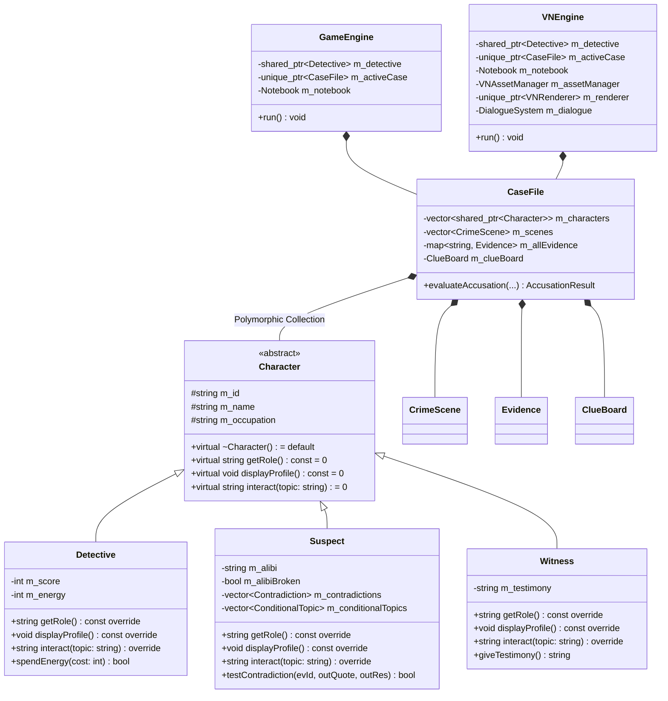

# CASE CLOSED — Detective Mystery Simulator

<div align="center">

```text
========================================================================
      ____    _    ____  _____   ____ _     ___  ____  _____ ____           
     / ___|  / \  / ___|| ____| / ___| |   / _ \/ ___|| ____|  _ \      
    | |     / _ \ \___ \|  _|  | |   | |  | | | \___ \|  _| | | | |     
    | |___ / ___ \ ___) | |___ | |___| |__| |_| |___) | |___| |_| |     
     \____/_/   \_\____/|_____| \____|_____\___/|____/|_____|____/      
========================================================================
     FORENSIC & DEDUCTIVE MYSTERY SIMULATOR IN STANDARD C++
      FEATURING THE NEW STREAMLINED OOP MYSTERY EDITION:
        "THE POISONED GLASS OF STERLING MANOR"
========================================================================
```

**An interactive mystery simulator demonstrating Object-Oriented Programming (OOP) fundamentals in Modern C++.**


<p align="center">
  🌐 <strong>Play the Game Online in your Browser:</strong><br>
  <a href="https://pra27-06.github.io/detective/"><strong>https://pra27-06.github.io/detective/</strong></a><br><br>
  🌟 <strong>Quick Start — Play the New Streamlined C++ Detective Game:</strong><br>
  Double-click <code>run_simple_detective.bat</code> or run <code>simple_detective.exe</code>
</p>

</div>

---

## 🌟 NEW: Streamlined Detective Game — "The Poisoned Glass of Sterling Manor"

Designed specifically to be **crystal-clear to understand, highly enjoyable, suspenseful, and a textbook demonstration of Object-Oriented Programming (OOP) in C++**.

### The Crime
At 11:15 PM during a sudden storm blackout, billionaire collector **Lord Arthur Sterling** is found dead in his study at Sterling Manor:
- **Cause of Death:** Potassium Cyanide poison in his crystal whisky glass.
- **The Scene:** The study door was locked from the inside, but the terrace window stood wide open with curtains flapping in the rain. His wall safe was cracked open, and a £50,000 diamond brooch was stolen!
- **The Suspects:**
  1. **Lady Evelyn Sterling (Widow & Heiress):** Her hands tremble, she tore her green velvet dress, and Sterling was about to cut her out of the will!
  2. **Dr. Arthur Bell (Family Physician):** Visibly sweating, repeatedly cleaning his spectacles; his prescription bottle of cyanide went missing from his medical bag during dinner!
  3. **Vincent Croft (Business Partner — THE CULPRIT):** Smug mining promoter with massive debts; smells of Havana cigars matching ash on the windowsill; has muddy boots and a broken pocket watch stopped at 11:15 PM with blood!
  4. **James Higgins (Head Butler — Witness):** Served the initial untainted drinks and overheard heated arguments.

### Core Gameplay Mechanics
1. **Explore Rooms & Search Hotspots:** Search the Study, Drawing Room, Coat Closet, and Garden Terrace for physical, chemical, and document clues.
2. **Interrogate Suspects:** Question alibis, motives, and secrets.
3. **Confront Suspect with Evidence:** Present contradictory clues (e.g. Havana Cigar Ash or the Cracked Watch to Vincent Croft) to trigger a dramatic **"OBJECTION! Contradiction Exposed!"** that breaks their alibi!
4. **Detective's Notebook:** View all discovered clues, suspect profiles, and their **Suspicion Meters (0% to 100%)**.
5. **Final Accusation:** Name the Killer, the Weapon, and the Decisive Smoking Gun proof to solve the case and earn **S-Rank Master Sleuth**!

### Core OOP Principles Showcased in C++
| OOP Concept | Implementation in Code |
|-------------|-------------------------|
| **Abstraction** | `IInspectable` abstract interface with pure virtual `inspect()`, `getName()`, `getDescription()`. `Character` abstract base class with pure virtual `interrogate()` and `getRole()`. |
| **Inheritance** | `Character` $\rightarrow$ `Suspect`, `Witness`. `Evidence` $\rightarrow$ `PhysicalClue`, `DocumentClue`, `ChemicalClue`. |
| **Polymorphism** | Virtual functions called through base-class smart pointers (`std::shared_ptr<Character>`, `std::shared_ptr<Evidence>`). Runtime dynamic dispatch on `interrogate()`, `inspect()`, and `confrontWithEvidence()`. |
| **Encapsulation** | Strict `private` data members (alibi, motive, secrets, suspicion score) with validated public getters/setters and state transition methods (`confrontWithEvidence()`). |
| **Templates / Generics** | `template <typename T> class CaseRegistry` providing a generic, type-safe container for both Evidence and Character collections. |
| **Operator Overloading** | Overloaded stream insertion operator `friend std::ostream& operator<<(std::ostream& os, const Evidence& ev)` for clean card printing. |
| **Modern C++ Safety** | Smart pointers (`std::shared_ptr`, `std::make_shared`), scoped enums (`enum class EvidenceType`), RAII, and exception handling.

---

## 1. Project Abstract & Tri-Edition Architecture

### Abstract
**CASE CLOSED** is a comprehensive detective mystery simulator developed in standard C++17. The player assumes the role of a consulting detective investigating three complex criminal mysteries. Progression is strictly logic-driven: examining crime scenes, collecting forensic and documentary evidence, questioning suspects with dynamic evidence-unlocked dialogue, confronting verbal contradictions, synthesizing breakthroughs on a Clue Board, and presenting an accusation to the court.

### The Tri-Edition Architecture (Model-View Separation)
To achieve both academic rigor, desktop performance, and instant web playability without compromising code quality, the project provides three distinct presentation targets driven by the exact same domain model:
1. **Web Browser Edition (Play Online via GitHub Pages):**
   - Zero-install, cross-platform client-side web edition playable directly at [https://pra27-06.github.io/detective/](https://pra27-06.github.io/detective/).
   - 100% responsive HTML5 Canvas/DOM presentation with Web Audio synthesized sound effects, typewriter dialogue, clickable scene hotspots, contradiction objection banners, and browser `localStorage` state persistence.
2. **2D Anime Visual Novel Desktop Edition (`case_closed_gui.exe`):**
   - High-definition 1280x720 16:9 graphical desktop window (Win32 + GDI+ hardware acceleration, `-lwinmm` audio).
   - Character portraits with expressive emotional reactions (neutral, nervous, angry, broken, thinking).
   - Clickable crime scene hotspots, visual Clue Board with red thread connections, and dramatic "OBJECTION!" contradiction confrontation banner.
   - Zero third-party library dependencies (uses native Windows APIs).
3. **Classic Terminal Edition (`case_closed_console.exe`):**
   - Pure C++17 Standard Library console application.
   - Detective-themed ASCII banners, framed dossier boxes, color-coded status, and safe stream-based input handling.
   - Zero graphical dependencies; runs in any Windows Terminal or shell.

All editions **share 100% of the underlying object-oriented game logic** (`CaseFile`, `Suspect`, `Witness`, `Evidence`, `CrimeScene`, `ClueBoard`, `Notebook`, `SaveManager`).

---

## 2. Key Objectives & Features

- **Standard C++17 Only:** Zero external third-party installations. Compiles cleanly with MinGW `g++`.
- **Three Original Mystery Cases:**
  1. *The Midnight Museum Heist:* Grand larceny of the 45-carat sapphire during a deliberate 4-minute blackout.
  2. *The Last Train Mystery:* Fast-acting cyanide poisoning of a shipping tycoon aboard an express liner with no stops.
  3. *The Locked Room Incident:* Homicide of an eccentric clockmaker inside a study bolted from the inside.
- **Deep Mystery Design:**
  - At least **4 suspects** per case with unique motives, personalities, and alibis.
  - At least **8 discoverable clues** per case with detailed forensic dossiers.
  - At least **2 misleading but fair red herrings** per case.
  - **Independent elimination evidence** ruling out all innocent suspects.
  - At least **3 meaningful contradictions** per case that shatter suspect alibis.
  - **Evidence-triggered conditional dialogue** unlocking deeper interrogation branches.
- **Deduction & Investigation Tools:**
  - **Crime Scene Exploration:** Search physical hotspots to uncover items.
  - **Clue Board:** Connect evidence pairs using virtual red thread to synthesize breakthroughs.
  - **Deduction Matrix:** Displays confirmed facts, active theories, and exposed contradictions.
  - **Notebook & Transcripts:** Record player field notes and review past suspect Q&A transcripts.
- **Save & Load Subsystem:**
  - Save progress midway through any case to a local, human-readable file (`saves/case_save.dat`) and resume anytime.

---

## 3. Architecture & Project Directory Structure

```text
detective/
├── .gitignore                # Git exclusions (binaries, object files, dynamic saves)
├── build.bat                 # Master build script (builds all or targeted edition)
├── build_console.bat         # One-click build script for Console Edition
├── build_gui.bat             # One-click build script for 2D Visual Novel Edition
├── run.bat                   # Unified launcher with edition selection menu
├── run_console.bat           # One-click launcher for Console Edition
├── run_graphical.bat         # One-click launcher for Visual Novel GUI
├── Makefile                  # Makefile supporting all, console, gui, clean targets
├── README.md                 # Project documentation and viva guide
│
├── assets/                   # Visual Novel Graphical Assets
│   ├── backgrounds/          # 1280x720 HD Scene Backgrounds (PNG)
│   ├── characters/           # Anime Character Portraits & Expressions (PNG)
│   ├── portraits/            # Scaled suspect interrogation avatars (PNG)
│   └── ui/                   # Dialogue boxes, nameplates, markers, objection banner
│
├── scripts/
│   └── generate_assets.py    # Python asset generator for backgrounds & anime sprites
│
├── include/                  # Modular C++17 Header Files
│   ├── Character.h           # Abstract base class (Abstraction & virtual interface)
│   ├── Detective.h           # Detective class (Score, energy, rank, hints)
│   ├── Suspect.h             # Suspect class (Alibis, contradictions, transcripts)
│   ├── Witness.h             # Witness class (Sworn testimony, eyewitness clues)
│   ├── Evidence.h            # Evidence data model, categories, and serializable cards
│   ├── CrimeScene.h          # Crime scene environment and search hotspots
│   ├── ClueBoard.h           # Deduction matrix and clue linking
│   ├── Notebook.h            # Detective's field notes and automated lead journal
│   ├── CaseFile.h            # Case coordinator, scenes, evidence, and accusation logic
│   ├── SaveManager.h         # Game state serialization with std::fstream
│   ├── TerminalUI.h          # ASCII banners, boxes, color palette, and input validation
│   ├── GameEngine.h          # Console game loop, state machine, and menus
│   ├── VNAssetManager.h      # GDI+ Bitmap cache and asset loading system
│   ├── VNRenderer.h          # Double-buffered 2D renderer for backgrounds, text & UI
│   ├── DialogueSystem.h      # Non-blocking typewriter dialogue engine & branching
│   └── VNEngine.h            # Visual novel window manager, input dispatch & screens
│
├── src/                      # C++17 Implementation Files
│   ├── Character.cpp
│   ├── Detective.cpp
│   ├── Suspect.cpp
│   ├── Witness.cpp
│   ├── Evidence.cpp
│   ├── CrimeScene.cpp
│   ├── ClueBoard.cpp
│   ├── Notebook.cpp
│   ├── CaseFile.cpp
│   ├── SaveManager.cpp
│   ├── TerminalUI.cpp
│   ├── GameEngine.cpp        # Console engine implementation
│   ├── VNAssetManager.cpp    # GDI+ Asset manager implementation
│   ├── VNRenderer.cpp        # GDI+ Double-buffered renderer implementation
│   ├── DialogueSystem.cpp    # Dialogue system implementation
│   ├── VNEngine.cpp          # Visual Novel engine implementation
│   ├── main.cpp              # Dedicated Console entry point
│   └── main_gui.cpp          # Dedicated Graphical Visual Novel entry point
│
├── docs/                     # University Documentation & Viva Guides
│   ├── CLASS_DIAGRAM.md      # Mermaid UML diagram and relationships
│   ├── OOPS_EXPLANATION.md   # Viva voce questions, model answers, and code mappings
│   └── TESTING_CHECKLIST.md  # Test scenarios, edge cases, and 100% walkthroughs
│
└── saves/                    # Local Save Data
    └── sample_save.dat       # Sample intermediate save file
```

---

## 4. Class Descriptions & OOPs Relationships



### Detailed Demonstration of OOPs Pillars:

1. **Encapsulation:**
   - Classes encapsulate private state variables (`m_score`, `m_alibiBroken`, `m_isDiscovered`, `m_culpritId`).
   - Mutation occurs solely through validated methods like `Suspect::testContradiction()` and `Detective::spendEnergy()`.
2. **Abstraction:**
   - Abstract base class [`Character`](include/Character.h) defines pure virtual operations (`getRole() = 0`, `displayProfile() = 0`, `interact() = 0`). Client code calls these contracts without needing to know specific derived class internals.
3. **Inheritance:**
   - [`Detective`](include/Detective.h), [`Suspect`](include/Suspect.h), and [`Witness`](include/Witness.h) all publicly inherit from `Character`, sharing common name, ID, and occupation attributes while extending specialized behaviors.
4. **Runtime Polymorphism:**
   - [`CaseFile`](include/CaseFile.h) stores characters uniformly inside `std::vector<std::shared_ptr<Character>>`.
   - Calling `character->displayProfile()` or `character->interact(topic)` executes specialized derived behavior at runtime through virtual table (`vtable`) dispatch.
5. **Composition & Aggregation:**
   - Both `GameEngine` (Console) and `VNEngine` (GUI) own `CaseFile` via `std::unique_ptr<CaseFile>`.
   - `CaseFile` owns `CrimeScene` objects, `Evidence` maps, and the `ClueBoard`.
6. **Decoupled Architecture (MVC):**
   - The game logic models are completely independent of UI code. `TerminalUI` handles text presentation, while `VNRenderer` handles double-buffered GDI+ vector graphics.

---

## 5. Compilation & Execution Commands

### Quick Launchers (Windows)

| Action | Command / Batch File | Description |
| :--- | :--- | :--- |
| **Launch Unified Menu** | `run.bat` | Presents menu to choose between Visual Novel and Console |
| **Play Visual Novel GUI** | `run_graphical.bat` | Launches 2D anime windowed game (`case_closed_gui.exe`) |
| **Play Console Edition** | `run_console.bat` | Launches classic terminal game in CMD/PowerShell |
| **Build Both Editions** | `build.bat` | Recompiles both executables |
| **Build Console Only** | `build_console.bat` | Recompiles `case_closed_console.exe` |
| **Build GUI Only** | `build_gui.bat` | Recompiles `case_closed_gui.exe` |

### Manual Compilation with MinGW g++

From the project root:

**1. Classic Console Edition:**
```bash
g++ -std=c++17 -Wall -Wextra src/Character.cpp src/Detective.cpp src/Suspect.cpp src/Witness.cpp src/Evidence.cpp src/CrimeScene.cpp src/ClueBoard.cpp src/Notebook.cpp src/CaseFile.cpp src/SaveManager.cpp src/TerminalUI.cpp src/GameEngine.cpp src/main.cpp -Iinclude -o case_closed_console.exe
```

**2. 2D Anime Visual Novel GUI Edition:**
```bash
g++ -std=c++17 -Wall -Wextra src/Character.cpp src/Detective.cpp src/Suspect.cpp src/Witness.cpp src/Evidence.cpp src/CrimeScene.cpp src/ClueBoard.cpp src/Notebook.cpp src/CaseFile.cpp src/SaveManager.cpp src/TerminalUI.cpp src/VNAssetManager.cpp src/VNRenderer.cpp src/DialogueSystem.cpp src/VNEngine.cpp src/main_gui.cpp -Iinclude -lgdiplus -lgdi32 -luser32 -mwindows -o case_closed_gui.exe
```

### Using Make
```bash
make          # Builds both editions
make console  # Builds case_closed_console.exe
make gui      # Builds case_closed_gui.exe
make clean    # Removes all executables
```

---

## 6. Visual Novel Controls & Gameplay

- **Dialogue Advancement:** Left-click anywhere on the dialogue box or press **Spacebar** / **Enter**. Clicking while text is typing immediately completes the current line. Clicking again advances to the next line.
- **Scene Investigation:** Click directly on illuminated hotspot markers to examine crime scenes and discover clues.
- **Suspect Interrogation:** Click suspect tabs on the left to interrogate them. Select topics or request sworn testimonies.
- **Confronting Contradictions:** Click *CONFRONT CONTRADICTION!* to open your collected evidence cards. Selecting the contradictory evidence triggers an "OBJECTION!" banner and forces confession!
- **Clue Board:** Click two evidence pins to link them with red thread. Finding valid pairs unlocks deductions.
- **Save / Load:** Instant single-click save and load anytime from the investigation screen.

---

## 7. Viva Voce Questions & Answers

1. **Q: Why did you create two separate executables?**
   - **A:** To demonstrate architectural decoupling and the Single Responsibility Principle. The core domain logic (`CaseFile`, `Suspect`, `Evidence`, `ClueBoard`, `SaveManager`) is a reusable Model layer. We built two independent View/Controller layers on top: a terminal controller (`GameEngine` + `TerminalUI`) and an event-driven graphical controller (`VNEngine` + `VNRenderer`). Neither edition alters or duplicates the detective rules.

2. **Q: How does runtime polymorphism work in Case Closed?**
   - **A:** The abstract base class `Character` has pure virtual methods `getRole()`, `displayProfile()`, and `interact()`. `CaseFile` maintains a polymorphic collection `std::vector<std::shared_ptr<Character>>`. When the player queries a suspect or witness, the compiler resolves the call through the virtual method table (`vtable`) to the appropriate derived class (`Suspect` or `Witness`).

3. **Q: How is memory managed without memory leaks?**
   - **A:** Through RAII (Resource Acquisition Is Initialization) and modern C++ smart pointers: `std::unique_ptr` for exclusive ownership (e.g., active case in the engine) and `std::shared_ptr` for shared reference counting (e.g., characters referenced across interrogation records). No manual `new` or `delete` operators are required.

4. **Q: How did you implement the visual novel without external dependencies?**
   - **A:** We used the native Windows Win32 API for double-buffered window management and GDI+ (Graphics Device Interface Plus) for hardware-accelerated 2D rendering, alpha-blended PNG sprites, anti-aliased typography, and geometric drawing. This ensures 100% portability on any Windows PC with MinGW without installing SDL2, SFML, or DirectX SDKs.

---

## 8. Git Commit & Push Instructions

All development has been completed on the `feature/visual-novel-ui` branch.

To commit and push to GitHub ([https://github.com/pra27-06/detective.git](https://github.com/pra27-06/detective.git)):

```bash
# 1. Open terminal in the project directory:
cd C:\Users\Prachi\OneDrive\Desktop\detective

# 2. Check repository status:
git status

# 3. Stage the files:
git add .

# 4. Commit:
git commit -m "feat: complete anime visual novel 2D GUI and preserve console edition"

# 5. Push to GitHub:
git push -u origin feature/visual-novel-ui
```
*(Do not push changes without explicit user authorization.)*
