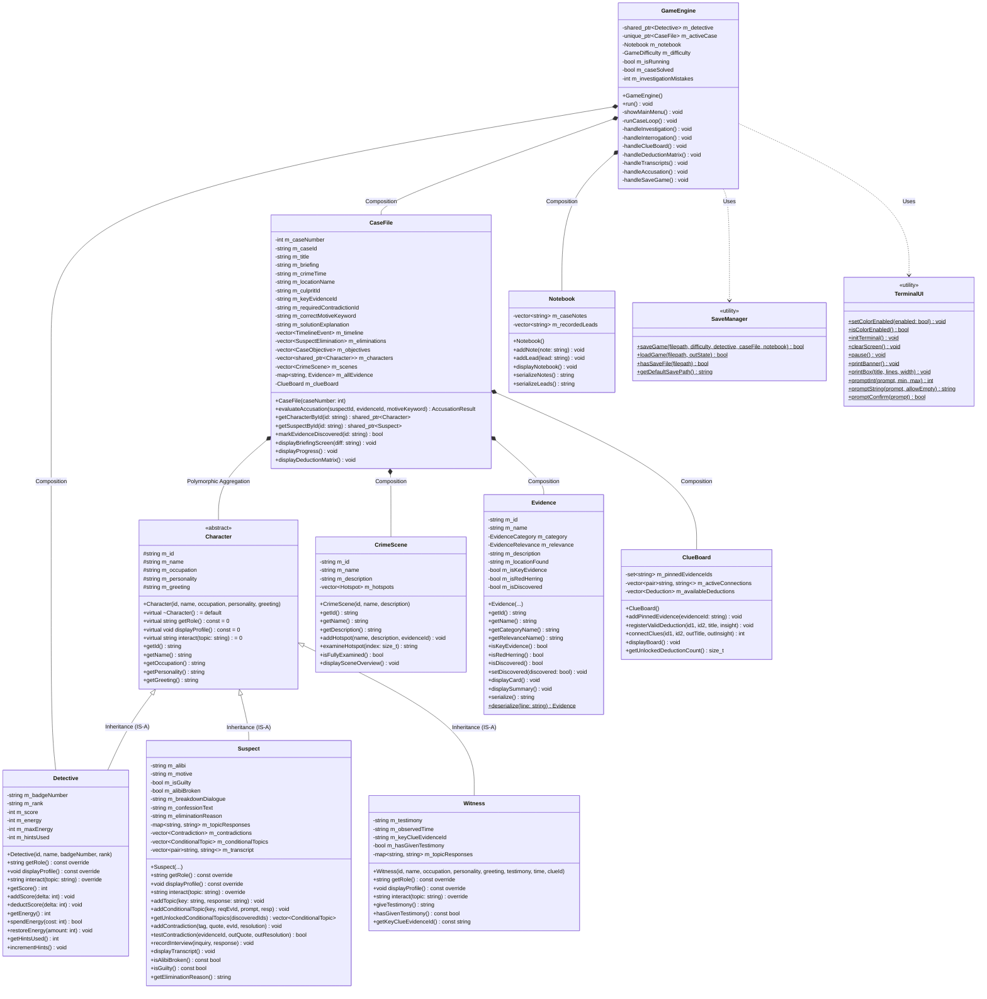

# CASE CLOSED — UML Class Diagram & Architecture

This document provides a comprehensive structural and behavioral blueprint of **CASE CLOSED — Detective Mystery Simulator**, highlighting standard UML notation, class specifications, and design patterns.

---

## 1. Complete UML Class Hierarchy

---

## 2. Key Object-Oriented Relationships Explained

| Relationship Type | Source Class | Target Class | Practical Implementation |
| :--- | :--- | :--- | :--- |
| **Inheritance** | `Character` | `Detective`, `Suspect`, `Witness` | Derived classes inherit common attributes (`m_id`, `m_name`, `m_occupation`) and implement the abstract interface. |
| **Polymorphism** | `CaseFile` | `std::shared_ptr<Character>` | Characters are stored uniformly in a `vector<shared_ptr<Character>>`. Dynamic dispatch executes `displayProfile()` and `interact()` based on the runtime type. |
| **Composition** | `CaseFile` | `CrimeScene`, `Evidence`, `ClueBoard` | `CaseFile` manages the lifecycle of its scenes, evidence records, and deduction matrix. When a case ends, these entities are released together. |
| **Composition** | `GameEngine` | `Detective`, `CaseFile`, `Notebook` | `GameEngine` acts as the central coordinator, owning the detective profile, active case file, and player notebook. |
| **Dependency / Usage** | `GameEngine` | `SaveManager`, `TerminalUI` | Stateless utility classes handle cross-platform file serialization and virtual terminal rendering. |
